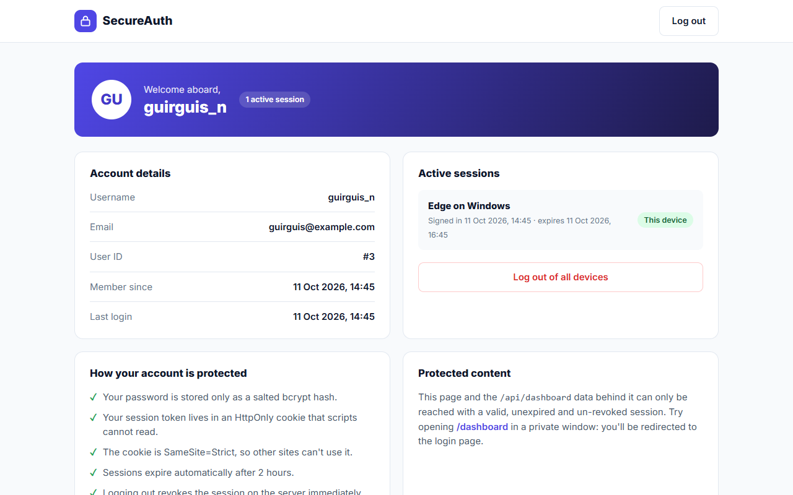
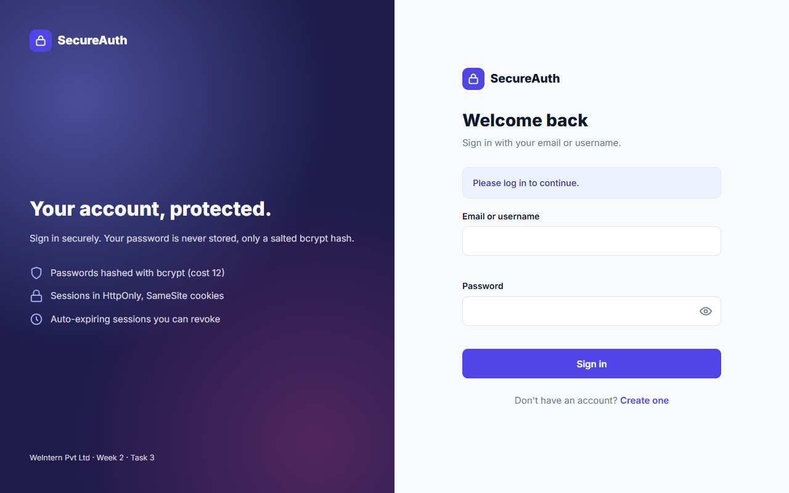
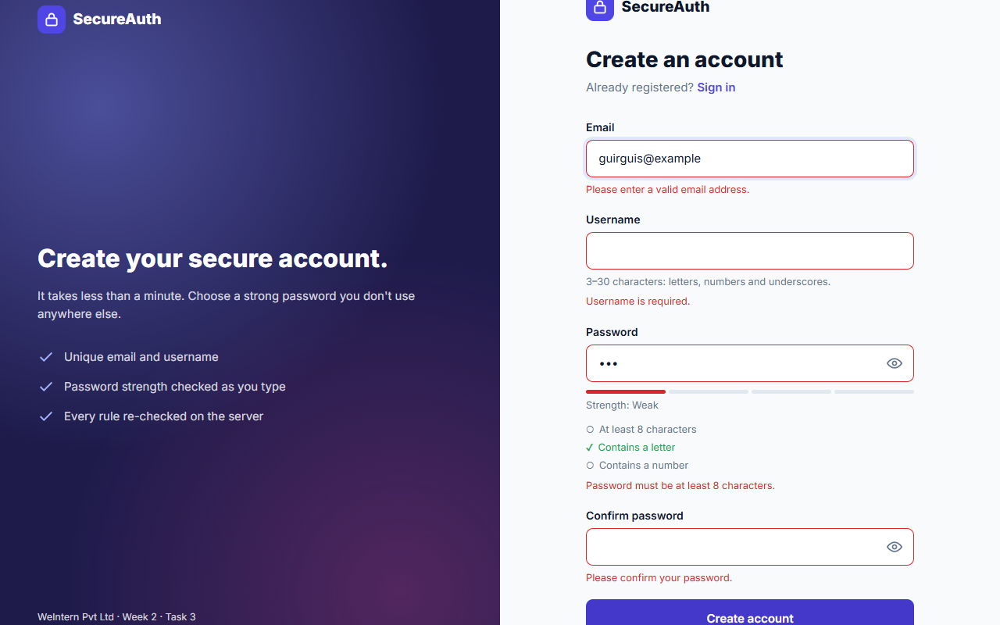
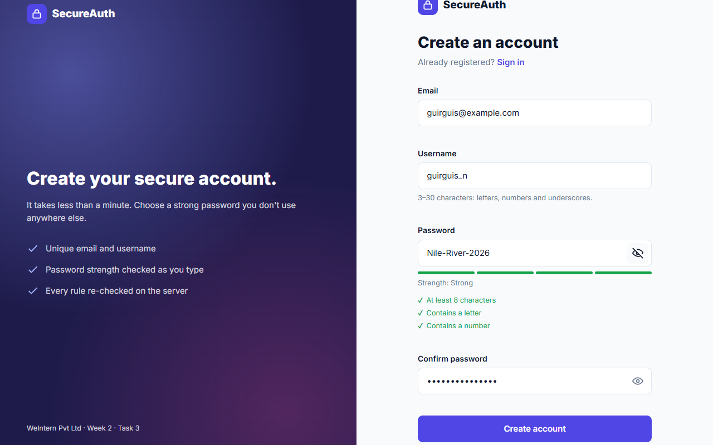
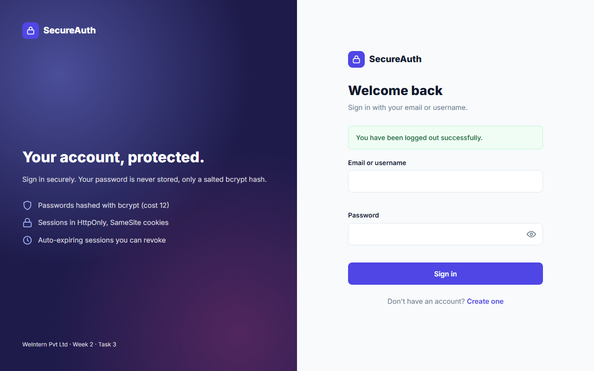
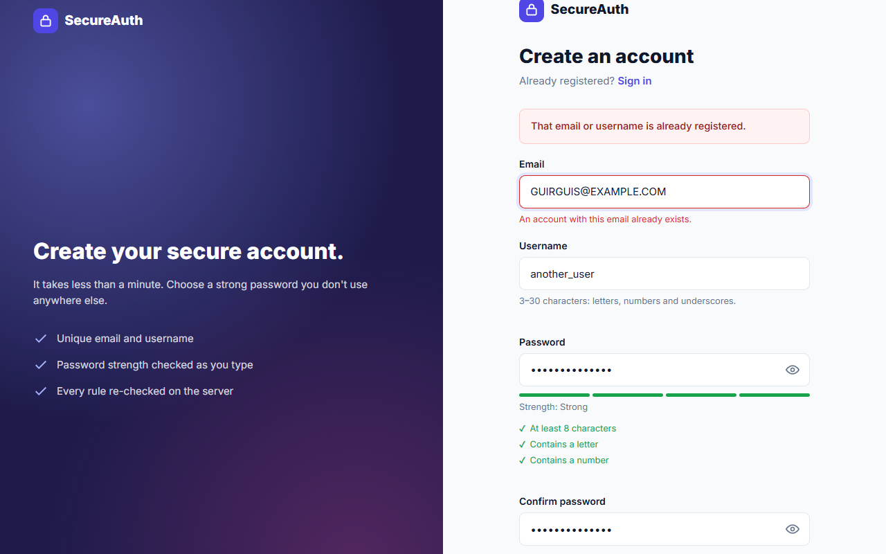
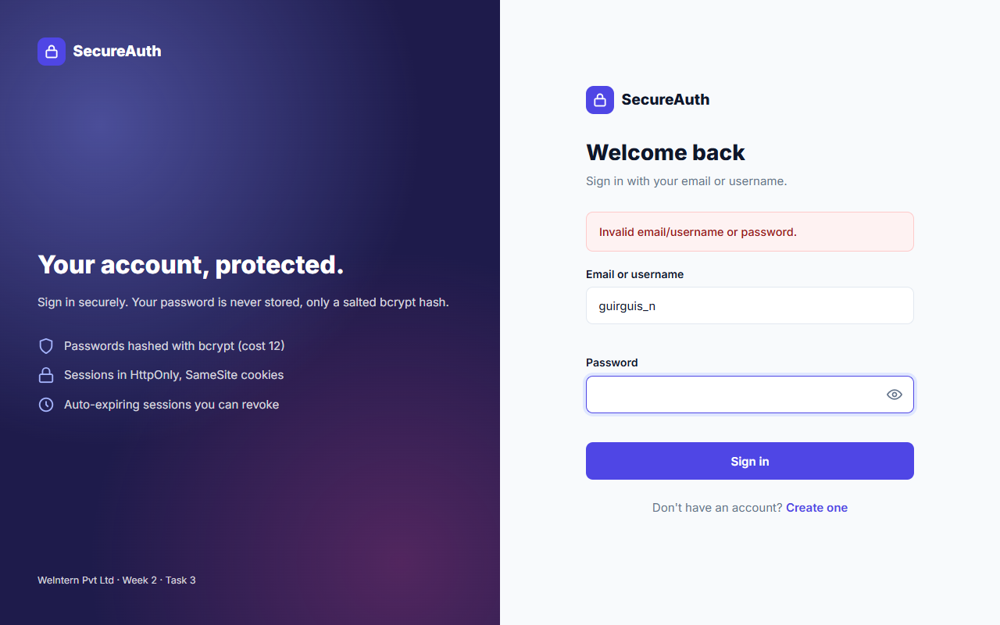
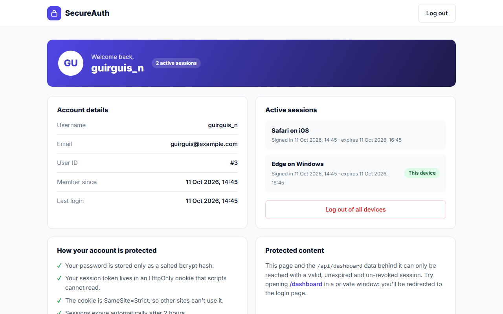

# Task 3 — Authentication System

**SecureAuth** is a secure registration and login system built with **Node.js, Express and SQLite**:
- passwords are hashed with **bcrypt**
- sessions use **JWTs stored in HttpOnly cookies** and can be revoked on the server
- there is a **protected dashboard**
- **logout really invalidates the token**



**Demo video:** [demo/auth-demo.webm](demo/auth-demo.webm). It shows protected-route redirection, validation, registration, the dashboard, logout, a duplicate email, a wrong password, login, and logging out of all devices.

## Features

| Requirement | Implementation |
|-------------|----------------|
| Registration with email, username and password | `POST /api/auth/register`, with live validation and a password-strength meter in the UI |
| Password hashing | **bcrypt** with cost factor 12 and a random salt per password (`src/auth/password.js`) |
| Login checks credentials against the DB | Log in with email **or** username; the bcrypt comparison runs in constant time |
| Session management | **JWT** (HS256) in an `HttpOnly; SameSite=Strict` cookie, expiring after 2 hours, plus a `sessions` table |
| Protected routes | `requireAuth` (API → 401) and `requirePageAuth` (pages → redirect to `/login`) |
| Logout invalidates the session | The session row is **revoked**, so even a copied token stops working. Logging out of all devices is supported too. |
| Clear error messages | Inline per-field errors, a generic "invalid credentials" message, a duplicate-account message and an expired-session message |

## Security notes

1. **Passwords are never stored.** Only bcrypt hashes are kept (`$2b$12$…`). Each hash contains its own random salt, so two users with the same password get different hashes. The cost factor of 12 makes each guess take about 250 ms, which makes brute-forcing a stolen database expensive.
2. **The 72-byte limit is enforced.** bcrypt ignores everything after 72 bytes, so longer passwords are rejected instead of being silently truncated.
3. **Password policy:**
   - at least 8 characters, with a letter and a number
   - common passwords are blocked
   - the password must not contain the username or the email name
   - the same rules run in the browser and on the server
4. **No user enumeration:**
   - an unknown user and a wrong password return the **same** message
   - an unknown user still triggers a bcrypt comparison against a dummy hash, so the response time is the same (measured: 557 ms vs 530 ms)
5. **Token storage: an HttpOnly cookie, not localStorage.** JavaScript (including any injected script) cannot read the token. `SameSite=Strict` stops other websites from sending it, which blocks CSRF, and `Secure` is enabled in production. The token never appears in a response body.
6. **JWT hardening:**
   - the algorithm is pinned to `HS256`, which blocks `alg: none` and algorithm-confusion attacks
   - issuer, audience and expiry are all verified
   - the payload holds only the user id and a session id, with no personal data
7. **Real logout.** A JWT normally stays valid until it expires. Here every token carries a `jti` (session id) that must exist in the `sessions` table and must not be revoked. Logout revokes it immediately, and "Log out of all devices" revokes every session.
8. **Brute-force protection.** Logins are limited to 10 failures per 15 minutes per IP (successful logins don't count), and sign-ups to 10 per hour per IP.
9. **CSRF protection in depth.** Besides `SameSite=Strict`, state-changing API requests are refused with 403 when their `Origin` header doesn't match the site.
10. **Injection and XSS prevention:**
    - every SQL query uses bound parameters
    - all input is type-checked, trimmed and length-limited
    - the frontend writes user data only with `textContent`
    - a strict **Content-Security-Policy** (from `helmet`) allows scripts only from this site, with no inline scripts or styles
11. **Other hardening:**
    - security headers from `helmet` (`X-Content-Type-Options`, `X-Frame-Options`/`frame-ancestors 'none'`, HSTS in production)
    - `X-Powered-By` is removed and the request body is capped at 10 KB
    - protected pages are sent with `Cache-Control: no-store`, so the Back button can't show them after logout
    - internal errors are logged on the server but never sent to the client
    - `?next=` redirects only accept paths on this site (prevents open redirects)
12. **Secrets come from the environment.** `JWT_SECRET` is read from `.env`, which is git-ignored. The server refuses to start in production without a secret of at least 32 characters.

**For a real production deployment**, also:
- serve the site over HTTPS (which makes the `Secure` cookie work)
- use a shared store such as Redis for rate limiting when running several instances
- add email verification and password reset

## Tech stack

| | |
|---|---|
| Backend | Node.js 22+, Express 5 |
| Database | SQLite (`better-sqlite3`) with SQL migration files |
| Auth | `bcryptjs` (bcrypt), `jsonwebtoken`, `cookie-parser` |
| Security | `helmet` (CSP and security headers), `express-rate-limit` |
| Frontend | HTML, CSS and JavaScript ES modules (no framework) |
| Tests | Node test runner (23 tests), a Playwright end-to-end run in Edge, and a Postman collection (26 assertions) |

## Project structure

```
Task-3/
├── src/
│   ├── server.js                  # entry point
│   ├── app.js                     # Express app: helmet, parsers, routes, pages
│   ├── config.js                  # env config (JWT secret, cookie flags, bcrypt cost)
│   ├── auth/                      # ← separate auth module
│   │   ├── index.js               # createAuthModule(db) → { router, requireAuth, … }
│   │   ├── auth.routes.js         # /api/auth/* + rate limiters
│   │   ├── auth.controller.js     # HTTP layer: validate → service → cookie
│   │   ├── auth.service.js        # register / login / authenticate / logout logic
│   │   ├── auth.middleware.js     # requireAuth, requirePageAuth, redirectIfAuthenticated
│   │   ├── auth.validators.js     # input validation + password policy
│   │   ├── password.js            # bcrypt hash / verify
│   │   └── token.js               # JWT sign / verify
│   ├── users/user.model.js        # SQL for users & sessions
│   ├── routes/dashboard.routes.js # example protected API
│   ├── middleware/                # error handler, origin (CSRF) check
│   └── db/
│       ├── index.js               # connection + migration runner
│       └── migrations/            # 001_create_users.sql, 002_create_sessions.sql
├── views/                         # login.html, register.html, dashboard.html
├── public/                        # css/, js/ (common, login, register, dashboard)
├── tests/auth.test.js             # 23 integration tests
├── docs/
│   ├── API.md                     # endpoint documentation
│   └── Auth-API.postman_collection.json
├── demo/auth-demo.webm            # demo video
├── screenshots/
└── .env.example
```

## Setup & run

**Requirements:** Node.js 22 or newer (the start script uses `--env-file-if-exists`).

```bash
npm install
cp .env.example .env          # then set JWT_SECRET (command below)
node -e "console.log(require('crypto').randomBytes(48).toString('hex'))"
npm start                     # http://localhost:3000
```

The database (`data/auth.db`) and its tables are created automatically on first start. Without a `.env` file the app still runs in development, using a temporary random secret, but logins are lost when the server restarts.

```bash
npm test      # 23 tests, in-memory database, fast bcrypt cost for speed
npm run dev   # auto-restart on file changes
```

## Testing

- **Integration tests** (`npm test`, 23 passing):
  - registration: success, bcrypt hash stored, normalisation, 9 invalid-input cases, duplicate email and username
  - login: by email or username, identical errors for a wrong password and an unknown user, a SQL-injection attempt, missing fields
  - protected routes: no token, valid token, **tampered token**, **wrong-secret token**, **`alg: none` token**, **expired token**, cross-site POST blocked
  - logout: **old token rejected after logout**, logout-all, logout without a session
  - pages: redirects, `no-store` caching and security headers
- **End-to-end** (Playwright driving Microsoft Edge): the full user journey shown in the demo video, with assertions at every step. It also checks that the cookie is HttpOnly, that `document.cookie` cannot read it, and that there are no console errors.
- **Postman/Newman:** 15 requests and 26 assertions, all passing.

## Screenshots

| | |
|---|---|
|  Protected route → login |  Registration validation |
|  Strength meter |  Protected dashboard |
|  Logged out |  Duplicate email |
|  Wrong password |  Two sessions + logout-all |

The mobile view is in [screenshots/09-mobile-login.png](screenshots/09-mobile-login.png).

## Author

**Guirguis Nashat**, Full Stack Development Intern at WeIntern Pvt Ltd  
GitHub: [guirguisnashat](https://github.com/guirguisnashat) · Email: guirguisnashatzakisoliman@gmail.com
